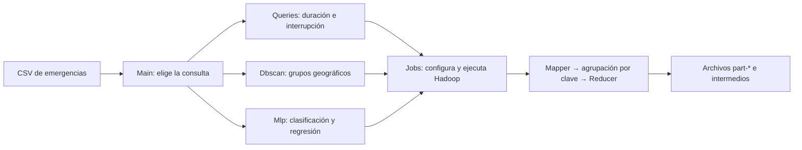

# Estructura y funcionamiento del proyecto CC531

Esta guía explica **qué hace cada archivo** y cómo una fila del CSV se convierte en un resultado MapReduce. Para los comandos de compilación y ejecución en las VM, usa la [guía de ejecución](GUIA_EJECUCION.md).

## 1. Idea general

El proyecto procesa emergencias de la red vial con cinco consultas. Todas leen el mismo CSV. Cada consulta crea uno o varios jobs de Hadoop; la salida de un job puede ser la entrada del siguiente.



En MapReduce, un **mapper** transforma una fila en pares `clave → valor`. Hadoop reúne los valores con la misma clave y los entrega a un **reducer**, que los agrega o calcula un resultado. Los archivos `part-*` contienen la salida; `_SUCCESS` indica que ese job terminó correctamente. Las rutas pueden estar en el disco local o en HDFS según la configuración de Hadoop.

## 2. Mapa de carpetas

```text
Parcial/
├── pom.xml                         Configuración Maven y dependencias
├── src/main/java/pe/edu/cc531/    Código Java de las consultas
│   ├── Main.java                   Entrada y selección de consulta
│   ├── Data.java                   Lectura del CSV y campos de cada fila
│   ├── Jobs.java                   Configuración común de jobs Hadoop
│   ├── Queries.java                Consultas duration e interruption
│   ├── Dbscan.java                 Consulta geográfica
│   └── Mlp.java                    Consultas mlp-class y mlp-reg
├── scripts/                        Compilación, medición y exportación
├── dist/                           JAR listos para copiar a las VM
├── target/                         Compilación generada por Maven
├── build/                          Copia del JAR general para scripts anteriores
├── results/local/                  Resumen de resultados locales verificados
├── powerbi/                        CSV preparado para el mapa en Power BI
├── GUIA_EJECUCION.md              Comandos para local, HDFS y YARN
├── README.md                       Descripción general del trabajo
├── CC531-parcial-20262.pdf        Enunciado del examen (solo local)
└── 3. Reporte Emergencias ...csv   Datos de entrada
```

`target/` se regenera con Maven. `dist/` recibe copias para la entrega. El PDF y `latex/` están excluidos de Git. `results/local/` contiene resultados resumidos de una ejecución previa; las ejecuciones nuevas crean sus propias carpetas de salida, fuera o dentro del proyecto según la ruta que indiques.

## 3. Datos de entrada: `Data.java`

El CSV tiene **1362 filas de datos y 22 columnas**, separadas por `;`, con texto en **Windows-1252**. [`Data.java`](src/main/java/pe/edu/cc531/Data.java) convierte los bytes que entrega Hadoop en texto con esa codificación y divide cada línea en 22 campos. Ignora la cabecera y valida ID, fecha y coordenadas. `safeParse` descarta las filas mal formadas y aumenta el contador Hadoop `input.invalid_rows`.

| Campo del CSV | Método en `Data.Row` | Uso principal |
|---|---|---|
| `ID_EMERGENCIA` | `id()` | Identificador, división entrenamiento/prueba |
| `FECHA_OCURRENCIA` | `occurrence()` | Duración y características de MLP |
| `EVENTO` | `event()` | Agrupación y característica de MLP |
| `DEPARTEMENTO` | `department()` | Duración y característica de MLP |
| `RED_AFECTADA` | `road()` | Interrupciones por vía |
| `ESTADO_INICIAL` | `initialState()` | Interrupción y clasificación |
| `FECHA_CIERRE` | `closure()` | Duración y regresión |
| `LATITUD`, `LONGITUD` | `lat()`, `lon()` | DBSCAN y características de MLP |

Las fechas se interpretan como `dd/MM/aaaa`. `Data.CUT` fija el corte en **20/08/2026**. `Data.haversine` calcula distancias entre coordenadas en kilómetros.

## 4. Entrada del programa: `Main.java`

[`Main.java`](src/main/java/pe/edu/cc531/Main.java) recibe la ruta de entrada, la ruta de salida y la consulta. Según el nombre, llama a `Queries.run`, `Dbscan.run` o `Mlp.run`. Usa `ToolRunner`, que permite pasar opciones de Hadoop como `-Dfs.defaultFS=file:///` antes de los argumentos del programa.

Hay dos formas de empaquetado:

| Archivo | Cómo selecciona la consulta |
|---|---|
| `cc531.jar` | Se indica la clase `pe.edu.cc531.Main` y luego `duration`, `interruption`, `dbscan`, `mlp-class` o `mlp-reg`. |
| `cc531-duration.jar`, etc. | El manifiesto del JAR apunta a una clase interna de `Main` que fija la consulta. No hay que escribir el nombre de consulta. |

Los **cinco JAR específicos contienen las mismas clases Java**; se distinguen por su nombre y por la clase de entrada declarada en el manifiesto. Esto permite entregar un JAR por consulta sin duplicar el código fuente.

## 5. Configuración común: `Jobs.java`

[`Jobs.java`](src/main/java/pe/edu/cc531/Jobs.java) concentra la configuración repetida de Hadoop:

- `raw(...)` crea un job para el CSV. Usa `NLineInputFormat`: por defecto, cada tarea map recibe **100 líneas**. También asigna el JAR, las rutas, el formato de salida de texto y el número de reducers.
- `text(...)` crea un job que lee la salida textual de una etapa anterior.
- `run(...)` espera a que termine el job y lanza un error si falló.
- `absent(...)` impide usar una carpeta de salida que ya exista.
- `eachLine(...)` lee los archivos `part-*` de una etapa. DBSCAN y MLP lo usan para cargar etiquetas, centroides o pesos del modelo.

Hadoop escribe claves y valores `Text` separados por tabulaciones. Por eso muchos archivos intermedios parecen tablas TSV. Un job con cero reducers produce archivos `part-m-*`; uno con reducers produce `part-r-*`.

## 6. Duración e interrupción: `Queries.java`

[`Queries.java`](src/main/java/pe/edu/cc531/Queries.java) comparte tres etapas entre ambas consultas. El booleano `cc531.duration` cambia los campos que produce el primer mapper y la fórmula del ranking final.

| Etapa | `duration` | `interruption` |
|---|---|---|
| `stage1` | Por departamento y evento: suma días hasta el cierre y cuenta casos válidos. | Por vía y mes: cuenta casos con estado inicial `INTERRUMPIDO` y casos totales. |
| `stage2` | Suma todos los eventos de cada departamento. | Suma todos los meses de cada vía. |
| `result` | Ordena por `días / casos` y conserva los diez departamentos mayores. | Ordena por `100 × interrumpidos / casos`; considera vías con al menos diez casos y conserva las diez mayores. |

Por ejemplo, en duración una fila válida produce una clave parecida a `TUMBES<TAB>Huaico` y un valor `días<TAB>1`. El reducer suma todos los valores de esa clave. Después `stage2` agrupa por `TUMBES`; finalmente `result` escribe rango, departamento, cantidad y promedio.

Duración excluye cierres vacíos, anteriores a la ocurrencia o posteriores al 20/08/2026. La salida principal de ambas consultas es `result/part-r-00000`; `stage1/` y `stage2/` se conservan para revisar el cálculo.

## 7. Agrupamiento geográfico: `Dbscan.java`

[`Dbscan.java`](src/main/java/pe/edu/cc531/Dbscan.java) implementa DBSCAN con radio de **20 km** y `minPts = 4`, contando el propio punto. Usa Haversine para decidir si dos emergencias son vecinas.

1. `candidates/`: cada punto se envía a su celda espacial y a ocho celdas vecinas. Dentro de cada celda se comparan pares y se conservan los que están a 20 km o menos.
2. `edges/`: elimina pares duplicados que aparecieron en más de una celda.
3. `core/`: reúne las coordenadas y vecinos de cada punto. Es **núcleo** si tiene al menos tres vecinos, además de sí mismo.
4. `labels-0000/`, `labels-0001/`, etc.: propaga entre núcleos el menor ID de su componente. Repite jobs hasta que el contador `dbscan.changed_labels` llega a cero.
5. `assignments/`: escribe `ID`, latitud, longitud, ID de grupo y tipo `core`, `border` o `noise`. Un punto de borde conectado a varios grupos toma el menor ID; el ruido usa `-1`.
6. `centroids/`, `scatter/` y `davies-bouldin/`: calculan los centros, dispersión media e índice Davies-Bouldin de los grupos sin ruido.

La grilla reduce el número de pares que se comparan; el criterio final de vecindad siempre usa Haversine. El índice Davies-Bouldin resume compactación y separación: un valor menor suele representar grupos más compactos y separados.

## 8. Aprendizaje automático: `Mlp.java`

[`Mlp.java`](src/main/java/pe/edu/cc531/Mlp.java) implementa una red neuronal pequeña sin biblioteca externa de aprendizaje automático. `mlp-class` y `mlp-reg` comparten casi todo el código; el parámetro `regression` cambia el objetivo, la salida y las métricas.

**Entrada del modelo.** Cada fila se convierte en 68 números: latitud, longitud, mes, día del año, 32 posiciones para `EVENTO` y 32 para `DEPARTEMENTO`. Los dos textos se convierten en posiciones con un hash estable. La red tiene 16 neuronas ocultas con `tanh`; la salida usa sigmoide para clasificación y valor lineal para regresión.

**Datos de entrenamiento y prueba.** El ID de emergencia y la semilla 42 producen una división determinista cercana a 80/20. En clasificación, `INTERRUMPIDO` es la clase 1 y `RESTRINGIDO` la clase 0; otros estados no se entrenan. En regresión, se usan cierres válidos hasta el corte. El objetivo se transforma con `log(1 + días) / log(162)`; las predicciones se vuelven a expresar en días al reportarlas.

**Secuencia de jobs.**

1. Solo en clasificación, `class-counts/` cuenta clases de entrenamiento y calcula un peso para la clase positiva (`negativos / positivos`).
2. `model-init/` guarda pesos iniciales generados con semilla 42.
3. Cada época crea un directorio `epoch-001/`, `epoch-002/`, etc. Los mappers acumulan gradientes de sus filas; un reducer suma esos gradientes y actualiza los pesos con tasa 0.1. Cada época escribe `LOSS` y `MODEL`.
4. `metrics/` evalúa por separado `train` y `test`. Clasificación informa accuracy, precisión, recall y F1. Regresión informa MAE y RMSE en días.
5. `predictions/` guarda, por ID, el conjunto (`train` o `test`), valor real y predicción.

El valor por defecto es **40 épocas**. El modelo de cada época se lee de los archivos `part-*` de la época anterior; por eso las carpetas intermedias forman parte del flujo del programa.

## 9. Maven y dependencias

[`pom.xml`](pom.xml) define un proyecto Java 11 llamado `pe.edu.cc531:cc531:1.0.0`.

| Dependencia o herramienta | Versión en el proyecto | Para qué se usa |
|---|---|---|
| JDK | 11 | Compilar y ejecutar las clases Java. |
| Hadoop `hadoop-common` | 3.3.0 | `Configuration`, `FileSystem`, `Path`, `Text`, `ToolRunner`. |
| Hadoop `hadoop-mapreduce-client-core` | 3.3.0 | `Job`, `Mapper`, `Reducer`, formatos de entrada y salida. |
| `maven-compiler-plugin` | 3.13.0 | Compila el código con `--release 11`. |
| `maven-jar-plugin` | 3.3.0 | Genera el JAR general y cinco JAR con manifiestos distintos. |
| Bash y Python 3 | Según el equipo | Scripts de construcción, medición y exportación. |

Las dos dependencias Hadoop usan alcance Maven **`provided`**. Sirven para compilar, pero no se empaquetan dentro de los JAR de 64 KB: al ejecutar `hadoop jar`, la instalación de Hadoop aporta esas bibliotecas. Los scripts Python usan la biblioteca estándar; no intervienen en las consultas MapReduce.

`mvn package` genera los JAR en `target/`. [`scripts/build.sh`](scripts/build.sh) ejecuta Maven y copia los seis JAR a `dist/`; además deja `build/cc531.jar` para scripts que todavía usan esa ruta.

## 10. Scripts y resultados auxiliares

| Archivo | Función |
|---|---|
| [`benchmark.sh`](scripts/benchmark.sh) | Ejecuta consultas repetidas y registra tiempos y muestras de recursos. |
| [`sample-node.sh`](scripts/sample-node.sh) | Muestrea CPU y memoria del nodo una vez por segundo. |
| [`summarize_benchmark.py`](scripts/summarize_benchmark.py) | Resume tiempos, CPU, memoria y speedup entre entornos. |
| [`verify_outputs.py`](scripts/verify_outputs.py) | Compara las salidas completas con cálculos independientes sobre el CSV. |
| [`export_powerbi.py`](scripts/export_powerbi.py) | Une asignaciones DBSCAN al CSV original y escribe un CSV UTF-8 para Power BI. |

[`results/local/`](results/local/README.md) contiene un resumen de resultados locales ya verificados. `powerbi/emergencias_clusters.csv` es un archivo generado para visualización. Las salidas de nuevas ejecuciones en HDFS **no aparecen automáticamente en el proyecto**: se leen con `hdfs dfs -cat` o se descargan con `hdfs dfs -get`, como explica la guía de ejecución.

## 11. Por dónde empezar a leer el código

1. Lee `Main.run` para ver cómo se elige una consulta.
2. Sigue `Queries.run` para entender tres jobs encadenados con pocos pasos.
3. Mira `Data.Row` y `Jobs.raw` para ver cómo se leen filas y se configura un job.
4. Pasa a `Dbscan.run` y después a `Mlp.run`: ambos siguen el mismo patrón de crear un job, esperar su resultado y usar sus archivos en el siguiente.

El código asume el esquema y la fecha de corte del CSV incluido. Además, DBSCAN carga etiquetas y puntos núcleo en memoria durante algunos mappers, y MLP lee el modelo completo en cada época. Eso es adecuado para este dataset pequeño; al usar archivos mucho más grandes habría que revisar esas decisiones.
